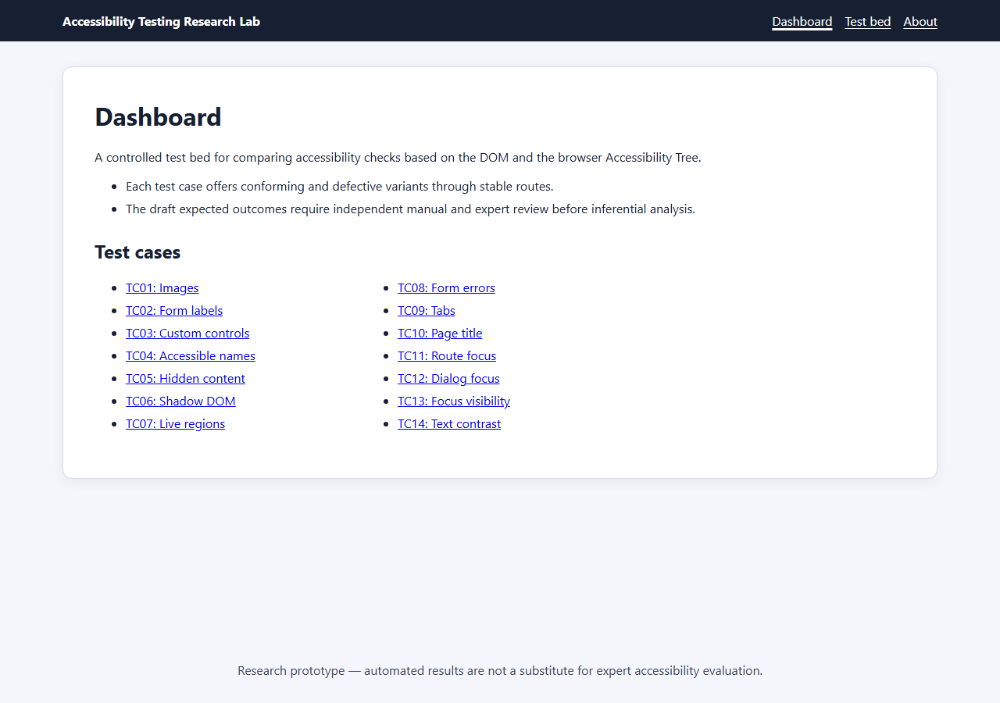
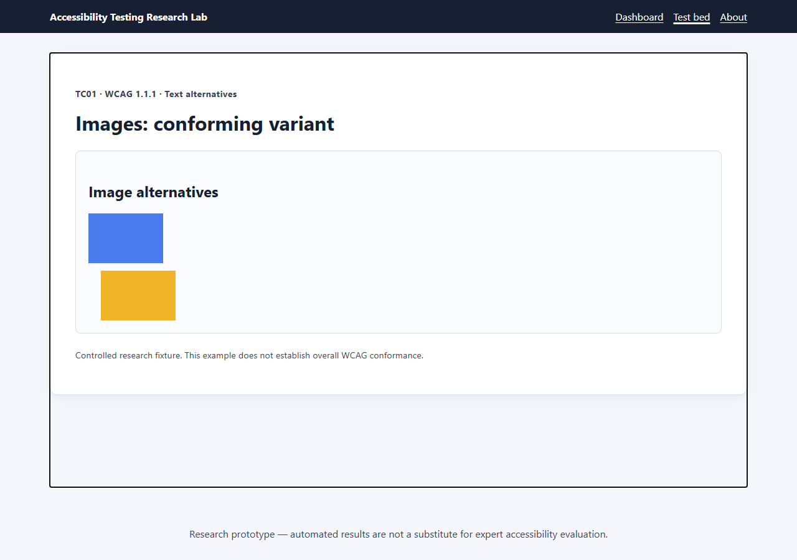
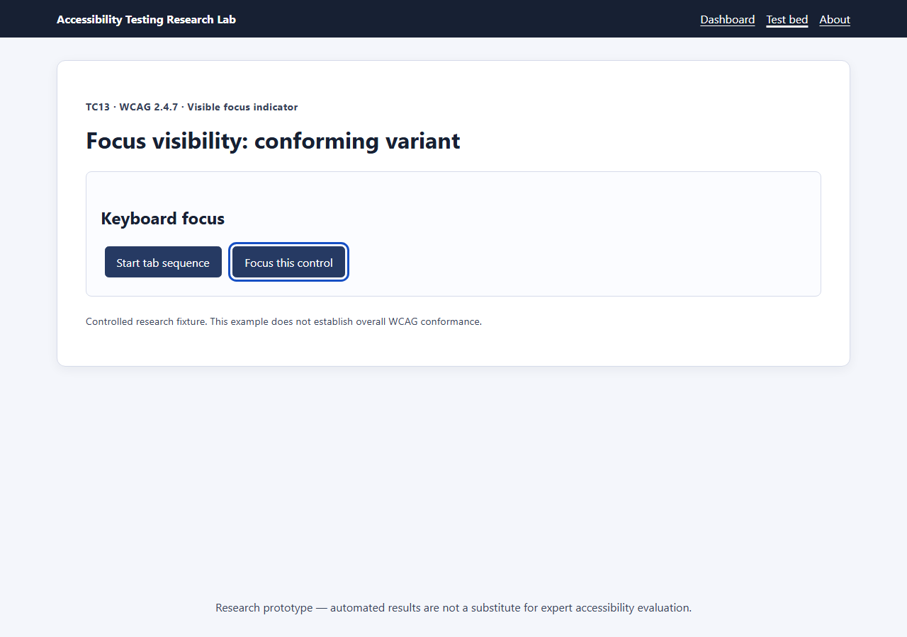
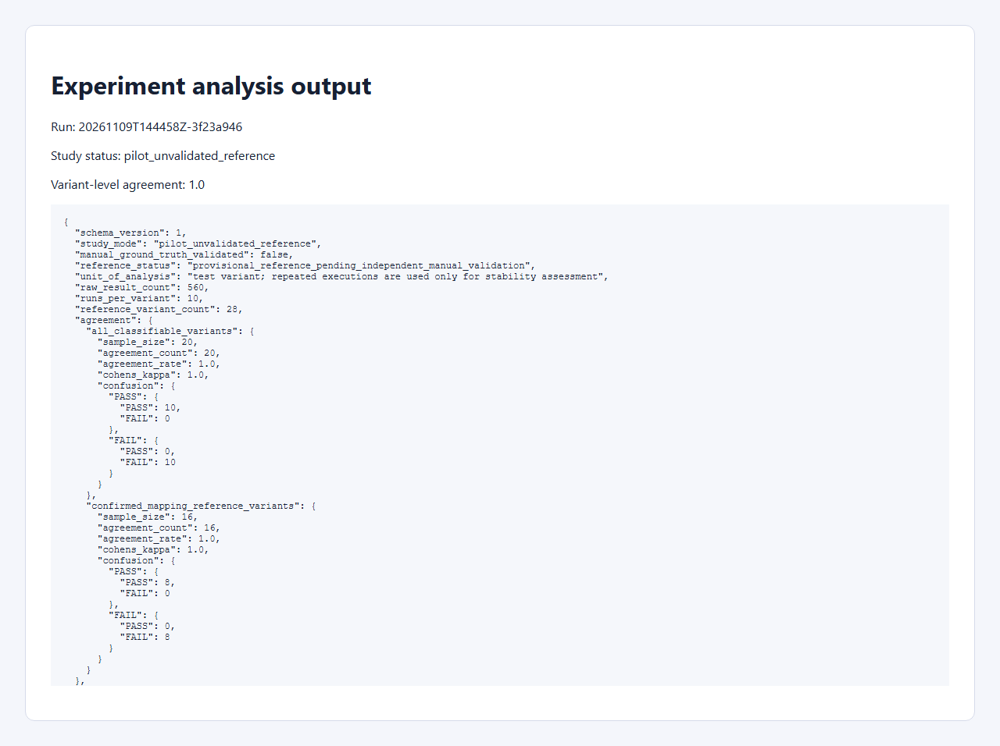

# Accessibility Testing Research Lab

A Flask-served single-page application and reproducible browser test bed for
comparing accessibility checks that use rendered DOM evidence with checks that
use Chromium's computed Accessibility Tree.

The project is research infrastructure, not a general accessibility checker.
Automated outputs are not declarations of overall WCAG conformance.

## Research question and approach

The primary question is whether DOM-based and Accessibility-Tree-based
automated checks produce different results on the same SPA variants. The
application implements the 14 proposed cases (28 conforming/defective fixture
variants). Each variant is exercised using both direct URL and in-app
navigation; navigation method is recorded as an experimental condition, not a
new test variant. Results are analyzed separately by navigation method, then
compared across methods before a single variant-level result is used. A
navigation-dependent verdict is marked unstable rather than averaged away.
Playwright for Python captures DOM and CDP
`Accessibility.getFullAXTree` evidence before and after interaction. The
independent engines consume only their own evidence source and emit a common
result format. TC13 and TC14 require rendering evidence, so both structural
engines report `NOT_TESTABLE`; their screenshots are retained separately.

Expected outcomes are predeclared in `testcases/ground_truth.json`, but remain
**provisional pending independent manual validation**. No screen-reader,
keyboard-only expert, or peer-rating work is claimed complete. Until that
review is recorded, runs are labeled `pilot_unvalidated_reference`, and
reported precision/recall/F1/accuracy are reference comparisons, not validated
ground-truth accuracy. No external review is part of the validation workflow. If
a human reviewer later becomes available, use
`testcases/manual_validation_protocol.md` and the blank
`testcases/manual_validation_template.csv`; the existing routes expose the
variant names, so the review is not fully blinded. Criterion mapping
rationales and source links are in `testcases/mapping_review.md`.

## Technology

- Python 3.10+
- Flask
- HTML5, CSS3, vanilla JavaScript, SPA hash navigation
- Playwright for Python and Chromium
- Chrome DevTools Protocol (CDP)
- JSON, CSV, pandas, NumPy, SciPy, statsmodels, matplotlib
- pytest

## Project structure

```text
app/                 Flask application, SPA template, CSS, JavaScript
testcases/           Case catalogue, provisional reference, spec generator
testcases/specifications/  28 generated per-variant specifications
runner/              Playwright evidence capture, repeated-run runner, screenshots
engines/             Independent DOM and Accessibility Tree rule engines
analysis/             Metrics, visualizations, disagreement review, report builder
reports/json/         Raw and summarized JSON output
reports/csv/           Flattened results and summary tables
reports/evidence/      Per-run DOM snapshots and Accessibility Tree captures
reports/figures/       Generated analysis figures
reports/screenshots/   Application screenshots
tests/                 Unit, catalogue, and Flask regression tests
```

## Install on Windows PowerShell

From the project root:

```powershell
py -3.10 -m venv .venv
.\.venv\Scripts\python.exe -m pip install --upgrade pip
.\.venv\Scripts\python.exe -m pip install -r requirements.txt
.\.venv\Scripts\python.exe -m playwright install chromium
```

Python 3.10 is the tested minimum in this workspace. Activate the environment
if desired with `.\.venv\Scripts\Activate.ps1`; direct interpreter commands
above work without activation.

### Environment and storage

`.venv` is a local, generated Python environment. It contains the installed
packages (including NumPy, SciPy, statsmodels, and Playwright), is excluded
from version control, and is not required to be kept between uses. In this
workspace it used about 488 MB; the exact size depends on Python and package
versions. Playwright's Chromium browser is installed separately and also uses
disk space.

To reclaim the environment's space, delete the project's `.venv` folder. This
does not delete the source code or saved experiment results. To use the
project again, recreate the environment by running the installation commands
above. The `reports/` folder contains generated results and evidence; old run
data can also take up space, so keep or remove it according to whether it is
still needed.

## Run the application

```powershell
.\.venv\Scripts\python.exe app\app.py
```

Open `http://127.0.0.1:5000`. The Dashboard links to the case variants. For
direct access, use a route such as
`http://127.0.0.1:5000/#/case/TC01/defective`. SPA navigation changes the
content without a full-page reload.

## Generate specifications and screenshots

With Flask running in another terminal:

```powershell
.\.venv\Scripts\python.exe -m testcases.generate_specs
.\.venv\Scripts\python.exe runner\capture_screenshots.py
```

The specification generator writes one JSON file per case/variant. Screenshots
are written to `reports\screenshots\`.










Experiment figures are named with their run ID under `reports/figures/`.
When preparing a submission, use only figures whose run ID matches the
experiment bundle and analysis cited in that submission; older pilot figures
are retained as historical artifacts.

## Capture one-off browser evidence

With Flask running:

```powershell
.\.venv\Scripts\python.exe runner\playwright_runner.py
.\.venv\Scripts\python.exe runner\cdp_capture.py
```

These initial smoke scripts save rendered HTML and a full Accessibility Tree
under `reports\smoke\`.

## Run the paired engines and experiment

With Flask running:

```powershell
.\.venv\Scripts\python.exe -m runner.experiment_runner --runs 10
```

This loads all 28 variants through both navigation methods, performs scripted
interactions (including sequential Tab navigation, keyboard activation only
after a target receives focus, dialog focus, route focus, and live-region updates), captures before/after DOM and AX
evidence, runs both engines, and writes a JSON bundle and flattened CSV. At 10
repeats, a complete run contains 1,120 engine results (28 variants × 2
navigation methods × 10 repeats × 2 engines). Navigation observations do not
increase the number of independent test variants. The manifest also records
execution failures, environment/version metadata, hashes of the catalogue and
expected-outcome file, and evidence-file references.

Until `manual_validation.completed` in `testcases\ground_truth.json` is
truthfully updated by an independent reviewer, output filenames begin with
`pilot_`; they must not be presented as confirmatory ground-truth results.
The runner does not set that flag automatically.

Run analysis against the matching JSON bundle:

```powershell
.\.venv\Scripts\python.exe -m analysis.metrics reports\json\pilot_<run-id>.json
.\.venv\Scripts\python.exe -m analysis.disagreements reports\json\pilot_<run-id>.json
.\.venv\Scripts\python.exe -m analysis.report reports\json\pilot_<run-id>.json reports\json\analysis_<run-id>.json reports\json\disagreements_<run-id>.json
```

The analysis produces a JSON/CSV summary, agreement and repeatability figures,
runtime plots, and `reports\research_report.md`. It computes variant-level
agreement, Cohen's kappa, binary confusion counts, precision/recall/F1,
exact McNemar on paired correctness, per-rule coverage, category summaries,
runtime, and repeat stability. `NOT_TESTABLE` and `INAPPLICABLE` are never
recoded as successful outcomes. Repeated runs are used for stability and are
not counted as independent variants.

## Test

```powershell
.\.venv\Scripts\python.exe -m pytest -q
```

## Human validation workflow

Manual validation is performed using the dataset and protocol in
`testcases/manual_validation_template.csv` and
`testcases/manual_validation_protocol.md`. Use the approved checklist in the
project review docs and complete one row per case/variant with observed
browser and assistive-technology evidence before treating any outcome as
confirmed.

## WCAG mapping and study limitations

- TC01–TC10 follow the proposal's core cases. TC03 separates 4.1.2 semantics
  from 2.1.1 sequential keyboard focusability and Enter/Space activation after
  focus; an activation attempt is not made when Tab does not reach the target.
  TC09 tests both tab selection and disclosure expanded state.
- TC02 is a fixture-specific visible-label `for`/ID relationship check, not a
  universal label checker; placeholder text is not treated as evidence of that
  relationship.
- TC05 references ACT rule 6cfa84. The rule concerns sequential focus
  navigation within `aria-hidden`; the AX-only engine reports
  `NOT_TESTABLE` when the tree does not expose the hidden ancestry.
- TC08 records error association as an observation but returns
  `NOT_TESTABLE` for criterion-level verdicts: lack of `aria-describedby` alone
  does not establish a 3.3.1 failure.
- TC11 and TC12 are operational focus observations with interpretive 2.4.3
  mappings; a focus-management issue is not automatically a failure.
- TC13 and TC14 need human visual review. Both structural engines return
  `NOT_TESTABLE` for rendered focus-indicator and contrast judgments; screenshots
  are retained as reviewer evidence.
- A static live-region snapshot cannot prove that a screen reader announced
  an update.
- The runner records the commit hash (and whether the working tree was clean)
  when the project is in Git; the archived pilot predates this and has
  `git_commit: null`.
- A small controlled test bed cannot establish general superiority of either
  engine.

See `docs/REVIEW_AND_TODO.md` for the prioritised submission checklist.

## Pending work before academic submission

1. Independent human validation of every expected outcome and criterion
   mapping, including screen-reader checks for live regions (not currently
   available; the AI review is not a substitute).
2. Reviewer adjudication of disagreement evidence and visual evidence for
   TC13/TC14.
3. Ten-run confirmatory experiment after reference validation.
4. Final report review against the official assignment brief.
